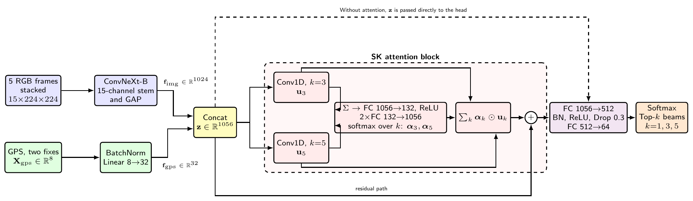

# Exploring Attention Techniques for RF-Free Cross-Scenario Beam Prediction from Camera Frames and GPS

Code and results for the paper of the same name by Mohamed Said and Nour Eldin Elmadany
(Arab Academy for Science, Technology and Maritime Transport, Alexandria).

Beam prediction uses only non-RF inputs: five camera frames and two GPS fixes. No received-power
measurement is given to the models. DeepSense 6G Scenarios 1 to 4 are used for training and the unseen
Scenario 5 is used for testing, with a 64-beam codebook and 2,296 test windows. The study goes in stages:
four visual backbones, four GPS models, concatenation of the best two, and four attention blocks applied to the
fused vector, once without and once with a residual connection.



## Results on Scenario 5

All numbers are accuracies in percent and come from single runs with seed 42. Random guessing gives
1.56 / 4.69 / 7.81 for Top-1 / Top-3 / Top-5. Every run is listed in
[`results/all_results.csv`](results/all_results.csv), together with the command that produced it.

**Vision only**

| Backbone | Top-1 | Top-3 | Top-5 |
|---|---|---|---|
| ResNet-50 | 8.32 | 35.89 | 53.48 |
| EfficientNetV2-RW-M | 43.82 | 77.53 | 90.77 |
| Swin-T | 44.95 | 77.96 | 88.76 |
| ConvNeXt-Base | **51.39** | **82.58** | **91.55** |

**GPS only**

| Model | Top-1 | Top-3 | Top-5 |
|---|---|---|---|
| Linear | **4.18** | **12.46** | **18.95** |
| MLP | 2.61 | 7.88 | 13.11 |
| Residual MLP | 2.61 | 7.80 | 11.06 |
| FT-Transformer | 2.61 | 8.06 | 16.55 |

**Concatenation and attention without residual connection** (ConvNeXt-Base with the linear GPS model)

| Fusion | Top-1 | Top-3 | Top-5 |
|---|---|---|---|
| Concatenation | 41.94 | 72.17 | 81.88 |
| SE attention | 43.95 | 74.83 | 85.19 |
| ECA attention | 45.17 | 80.40 | 89.68 |
| UFO attention | **47.08** | 75.87 | 85.71 |
| SK attention | 46.91 | **81.93** | **90.51** |

**Attention with residual connection**

| Fusion | Top-1 | Top-3 | Top-5 |
|---|---|---|---|
| SE attention | 45.21 | 78.27 | 86.98 |
| ECA attention | 40.68 | 71.25 | 81.27 |
| UFO attention | 50.04 | 85.98 | 94.29 |
| SK attention | **53.70** | **88.50** | **95.47** |

**Comparison with the DeepSense 6G leaderboard on Scenario 5**

| Method | Top-1 | Top-2 | Top-3 | Top-5 |
|---|---|---|---|---|
| Leaderboard entry, vision only | **58.27** | **79.47** | **92.72** | not reported |
| This work, vision only | 51.39 | not run | 82.58 | 91.55 |
| This work, vision and GPS with SK attention | 53.70 | not run | 88.50 | **95.47** |

The leaderboard entry is higher in Top-1 and Top-3. The comparison is not like-for-like, because the models
here never see Scenario 5 during training, and the leaderboard page does not state the training data of its entry.

### Please read: single-run caveat
Additional runs with other seeds exist only for concatenation, SE attention and SK attention
(rows `additional_seeds` in the CSV). The SK attention Top-1 was 53.70, 44.47 and 52.87 for seeds 42, 1 and 2.
The variation between runs is of the same size as the differences between the attention blocks, so the ranking
of the blocks is not established. Three more SK variants that are not in the paper tables are listed in the CSV
under `extra_variants`. The validation split is a random split of overlapping windows and is optimistic.

## Repository layout

```
src/                         all training and evaluation code
  common.py                  data pipeline and training loop for the vision-only and GPS-only scripts
  v1_resnet50.py ... v4_*.py vision-only experiments
  g1_linear.py ... g4_*.py   GPS-only experiments
  fusion.py                  fusion experiments, produced the SK attention checkpoint
  fusion_v2.py               fusion experiments with a seed argument and the residual variants
  evaluate_checkpoint.py     evaluate a released checkpoint on Scenario 5
  collect_results*.py        collect result files into tables
scripts/run_paper_experiments.sh   all experiments in the order of the paper
results/all_results.csv      every run
results/raw/                 original json result files
weights/                     description of the released checkpoints
docs/                        architecture figure
```

## Names in the paper and commands

| Paper | Command |
|---|---|
| Concatenation | `python fusion_v2.py C0 42` |
| SE, ECA, UFO attention without residual | `python fusion.py A1_SE`, `A4_ECA`, `A2_UFO` |
| SK attention without residual | `python fusion_v2.py S1_SK_NoRes 42` |
| SE, ECA, UFO attention with residual | `python fusion_v2.py R1_SE_Res 42`, `R3_ECA_Res 42`, `R2_UFO_Res 42` |
| SK attention with residual | `python fusion.py A3_SK` |

The seed-42 runs of the attention blocks without residual and of SK attention come from `fusion.py`, an earlier
script that is equivalent to `fusion_v2.py` with seed 42. Rerunning with `fusion_v2.py` gives slightly different
numbers, since training is not deterministic.

## Setup

```bash
pip install -r requirements.txt     # PyTorch 2.3 or newer is needed
```

Download DeepSense 6G Scenarios 1 to 5 from https://www.deepsense6g.net and follow the dataset terms. The data
is not part of this repository. The scripts expect `ROOT/ScenarioN/ScenarioN/scenarion.csv` with the image and
GPS folders next to it. `ROOT` is set at the top of `common.py`, `fusion.py`, `fusion_v2.py` and
`v4_convnext_base_fast.py`. The default is `/content`, which is the Colab layout.

## Run

```bash
cd src
python v4_convnext_base_fast.py     # vision only, ConvNeXt-Base
python g1_linear.py                 # GPS only, linear model
python fusion_v2.py A3_SK 42        # fusion with SK attention, seed 42
python collect_results_v2.py        # table of the finished runs
```

`fusion_v2.py` accepts `C0, A1_SE, A2_UFO, A3_SK, A4_ECA, R1_SE_Res, R2_UFO_Res, R3_ECA_Res, S1_SK_NoRes,
S2_SK_k3, S3_SK_k357, S4_VisSK_noGPS` and an optional seed. A fusion run takes about 28 minutes on one Colab
GPU. The first run builds a cache of the resized frames, which takes a few minutes.

## Weights

Three checkpoints are attached to the GitHub release **v1.0**: TODO add link. They are described in
[`weights/README.md`](weights/README.md).

```bash
cd src
python evaluate_checkpoint.py ../weights/F_A3_SK_best.pth --model sk_attention
```

## Data citation

If the DeepSense 6G data is used, the dataset paper and the vision-position paper have to be cited:

```
@article{DeepSense,
  author  = {Alkhateeb, Ahmed and Charan, Gouranga and Osman, Tawfik and Hredzak, Andrew and Morais, Joao and Demirhan, Umut and Srinivas, Nikhil},
  title   = {DeepSense 6G: A Large-Scale Real-World Multi-Modal Sensing and Communication Dataset},
  journal = {IEEE Communications Magazine},
  year    = {2023}
}
@inproceedings{9771573,
  author    = {Charan, Gouranga and Osman, Tawfik and Hredzak, Andrew and Thawdar, Ngwe and Alkhateeb, Ahmed},
  booktitle = {2022 IEEE Wireless Communications and Networking Conference (WCNC)},
  title     = {Vision-Position Multi-Modal Beam Prediction Using Real Millimeter Wave Datasets},
  year      = {2022},
  pages     = {2727--2731},
  doi       = {10.1109/WCNC51071.2022.9771573}
}
```

## Citation and license

Citation information is in `CITATION.cff`. The code is released under the MIT license. The DeepSense 6G data
and the ImageNet-pretrained weights come with their own licenses.
